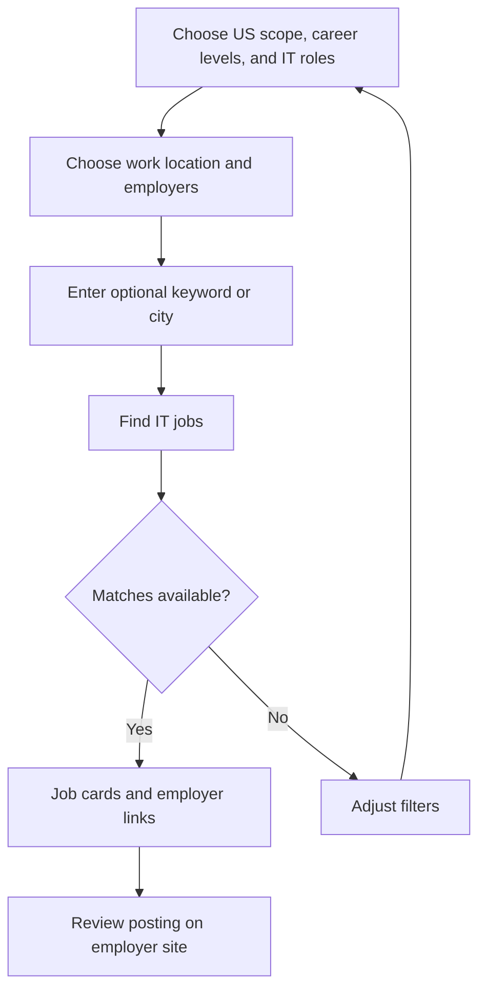
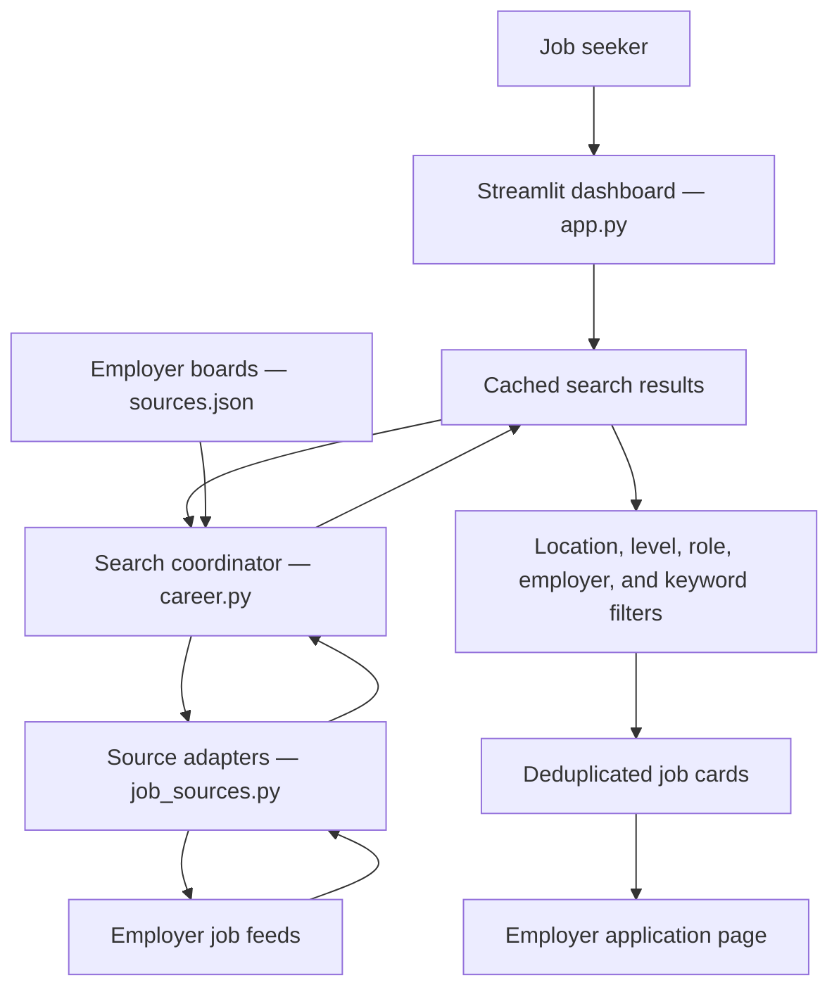
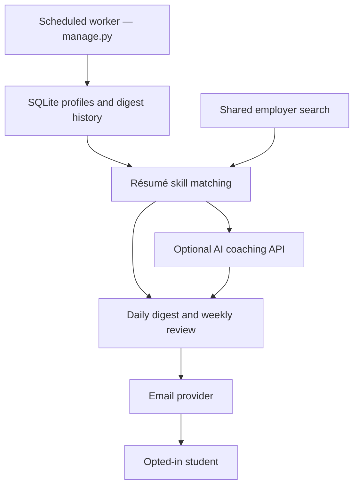

# Career Launch Agent

## Selected project option

**AI-assisted career and job-search application built with Python and Streamlit.** This is the working description of the selected project option. The exact option name or number should be checked against the course sample before submission.

## Problem and intended users

Graduating students often search several employer websites to find jobs that match their interests and location. Similar job titles can describe different responsibilities, and students may spend time reviewing positions outside their preferred area or experience level.

Career Launch Agent brings listings from configured employer boards into one search page. Users select IT role categories, any US state or nationwide search, career level, work location, employers, and an optional keyword or city. Results link to the employer's posting so users can review requirements and apply.

The intended users are graduating Information Systems and Computer Science students at Catawba College, along with other early-career IT job seekers. The initial focus is help desk, desktop support, networking, data center, systems, cloud, and cybersecurity work across the United States.

## Current scope and planned features

| Component | Current status |
| --- | --- |
| Public Streamlit dashboard | Opens directly to job filters |
| Employer job retrieval | Uses configured employer feeds and careers search endpoints |
| Search matching | Filters listings by US location, career level, role, employer, and keyword |
| Appearance | Light and dark selector, with results retained when switching |
| Employer application links | Displayed with each result |
| Résumé-based skill ranking | Implemented in the separate pilot workflow |
| Daily email digest and weekly summaries | Separate pilot tools requiring profiles, credentials, and a running worker |
| Optional AI coaching | API integration in the pilot tooling, requiring configuration and user opt-in |

The current public dashboard uses the user's selected filters. Résumé upload, email subscription, and AI coaching are not connected to this dashboard. Integrating those features into a usable personal-agent workflow remains future work.

## Data and API plan

### Sources and retrieval

The application reads employer configuration from `sources.json`. The source adapters in `job_sources.py` retrieve JSON listings from Greenhouse, global Lever, SmartRecruiters, and Amazon careers search. Each configured employer has a provider name and board identifier. The source list is a limited set of employers, so search coverage depends on those configured boards.

The implementation supports public feeds, but availability and permitted use must be reviewed for each provider before expanding deployment. Amazon careers search is a public search endpoint that may change independently of the application. The app uses read-only requests and sends users to the employer's application page.

### Processing

1. Load the configured employer boards.
2. Fetch employer data concurrently with up to six workers. Feed requests use timeouts and limited retries, and failures produce source warnings.
3. Convert provider-specific fields into common job records containing title, company, location, description, and application URL. Some providers also supply publication dates, experience-level metadata, and minimum qualifications.
4. Convert HTML descriptions into text for keyword processing. Validate application links as HTTPS URLs.
5. Apply the user's selected filters and remove duplicate listings with the same normalized URL. Different URLs for the same opening may still appear separately.
6. Display the results with employer links. Streamlit caches source results for up to 15 minutes to reduce repeated requests.

### Matching users to jobs

The public dashboard checks job titles against the selected IT role categories. It checks location metadata against the selected US states or nationwide scope and explicit US-remote labels. The employer filter limits companies, and the optional keyword searches title, employer, location, and description. Results are sorted by title and company.

The separate résumé-based pilot compares a skills profile with a fixed skill vocabulary in each description. Its heuristic gives 40 points for a matching title and eight points per shared skill, capped at 100. It identifies skills mentioned in a posting that the profile does not show. These scores help order results and require human review of actual experience and qualifications.

### AI and storage plan

The pilot's optional OpenAI API integration generates brief coaching from job titles and matched or unverified skill keywords. It supplements the deterministic matching process. API errors fall back to the standard digest. Model access and credentials must be configured before live use.

The public search page uses cached job data and does not require an account. The separate pilot uses SQLite for student profiles, application history, activities, and delivery tracking. Credentials belong in local environment variables or deployment secrets, with access limited to the operator. A future hosted student pilot needs a durable data store, verified student access, opt-in email delivery, and tested data deletion and recovery.

## Preliminary user interface sketch

The filter controls are grouped in a sidebar. The main area contains a welcome panel, result count, and job cards arranged in two columns on larger screens.

| Page area | Left column | Right column |
| --- | --- | --- |
| Header | Career Launch Agent | |
| Search controls, first row | Search area — anywhere in the US or selected states | Work location — site-based, include US remote, or US remote only |
| Search controls, second row | IT role categories | Employer selection |
| Additional filters | Career level — Intern, Early, Mid, Senior, Unspecified | Keyword or city |
| Appearance | Light or Dark theme selector | |
| Main action | Find IT jobs button | |
| Results | Matching job count and source warnings when needed | |
| Repeated job card | Job title, company, and location | View employer posting button |
| Empty state | Message suggesting broader filters when no jobs match | |



## Application architecture



The coordinator gathers listings, and the dashboard applies the selected filters. Each provider adapter converts its response to the common job format. This lets the dashboard display results from different sources using the same layout.

The separate pilot tooling follows this architecture when configured.



## Anticipated development challenges

| Challenge | Approach |
| --- | --- |
| Limited job coverage and changing source formats | Keep provider adapters separate, test them with sample responses, and add employers that regularly advertise entry-level IT work. Show source failures so partial results are clear. |
| Relevant titles with unsuitable qualifications | Review sample matches against real postings, expand title synonyms, and present skills and requirements for review. Measure relevance with student feedback before depending on automated ranking. |
| Ambiguous location and remote eligibility | Match posted location metadata, distinguish remote selections, and ask users to confirm employer eligibility. Add structured location fields as sources support them. |
| Duplicate, closed, or outdated listings | Normalize URLs, deduplicate results, refresh cached data, and spot-check links. Add explicit closure and freshness checks where the provider exposes reliable fields. |
| Slow searches, timeouts, and rate limits | Use limited parallel requests, caching, timeouts, and bounded retries. Continue with available boards and display warnings for failed ones. |
| Reliable email delivery and student data | Keep credentials outside GitHub, track delivery reservations, respect opt-in settings, and test retries and data access before a student pilot. Use a durable host for scheduling. |
| Unsupported AI advice or unnecessary cost | Send a small, evidence-based input, bound the response length, make coaching optional, and retain a fallback digest. Evaluate generated advice before broader student use. |

## AI assistance statement

ChatGPT assisted with planning Career Launch Agent, generating and revising Python code, developing the Streamlit interface, suggesting source integrations, troubleshooting signup and deployment issues, and drafting project documentation and verification checks. AI assistance also helped organize this README around the instructor's feedback.

Substantial portions of the implementation and documentation were AI-generated. The developer is responsible for reviewing the code, understanding its behavior, validating results, and correcting errors before presenting or deploying the project. The optional coaching API is a separate runtime feature from the AI tools used during development.

## Installation and running the application

### Streamlit deployment through GitHub

1. Commit the extracted project files to the branch connected to the Streamlit deployment. Keep `app.py`, `requirements.txt`, and the supporting Python and JSON files together.
2. Set the main file path to `app.py` when the files are at the repository root, or `career_launch_agent/app.py` when they are in that folder.
3. Open the app, select filters, and click **Find IT jobs**. Public search requires no signup secrets or email credentials.

### Local setup

Use Python 3.12. On Windows, double-click `Start_Career_Launch_Agent.cmd` from the extracted project folder. Alternatively, run the following commands from that folder.

```bash
python -m pip install -r requirements.txt
python -m streamlit run app.py
```

Optional pilot email and coaching tools require their own configuration. Copy `.env.example` to `.env` and configure the credentials locally before using those tools. Keep `.env` and any private database outside GitHub.

## Project structure

| File | Responsibility |
| --- | --- |
| `app.py` | Public search interface, theme, filtering, and job cards |
| `filters.py` | US state matching and estimated career levels |
| `sources.json` | Employer boards and matching vocabulary |
| `job_sources.py` | Provider adapters, normalization, and pilot ranking |
| `career.py` | Search coordination, coaching, digest formatting, and summaries |
| `database.py` | Private pilot data access |
| `manage.py` | Pilot invitations, scheduled delivery, and aggregate reporting |
| `settings.py` | Environment settings and time zone handling |
| `requirements.txt` | Python dependencies |

## Verification and evaluation plan

Existing dashboard checks cover filter combinations, repeated URLs, empty results, and warnings using sample postings. Live feed and email behavior require separate verification in the deployment environment.

Before a student pilot, review a sample of search results for correct IT category and location, check employer links, and record which sources fail. For a future 90-day pilot with 5–10 volunteers, collect recommendation feedback and track participation, applications, interviews, and offers. The initial planning targets are 80% weekly participation and 90% valid employer links. These are proposed targets rather than measured outcomes.


## November 20 filter and appearance update

- Select **Anywhere in the US** or **Selected states**. State choices include all 50 states, Washington DC, Puerto Rico, Guam, and the US Virgin Islands.
- Choose **Intern**, **Early**, **Mid**, or **Senior**. Multiple selections are allowed. Keep **Unspecified** selected to include listings whose career level cannot be inferred.
- Choose **Light** or **Dark** above the search form. The selection lasts for the current session, and completed search results remain visible when the theme changes.
- Use work location to choose site-based jobs, include US-remote listings, or show US-remote listings only. Remote listings still require checking employer eligibility.

Career levels use available employer metadata, then title signals such as intern, junior, II, senior, or lead, and stated minimum experience where supplied. Mixed or ambiguous titles can be classified incorrectly. Review the original posting. Selected levels filter results and do not certify qualifications.

Nationwide search uses the configured employers and source limits. Amazon currently retrieves up to 50 results per search phrase and location, so the result list is not exhaustive. Generic remote listings without identifiable US eligibility are omitted. Themes use CSS for this Streamlit dashboard and can require adjustment if Streamlit changes widget styling.

To update an existing GitHub deployment, replace the project files in the same directory, including the new `filters.py` and this `README.md`. Keep the existing Streamlit main-file path, such as `AI-AGENT/app.py`.


## Visual layout update

The dashboard uses an Inter/Segoe UI font stack, an indigo primary action, rounded panels, and consistent light and dark palettes. Appearance and job filters are in the sidebar. Results display company, job title, location, estimated career level, and an employer link in two-column cards. The main area provides clear initial, empty, and source-error states. Streamlit adapts columns to smaller screens, and the sidebar can be opened with its standard control.

Upload the updated `app.py` with the rest of the project files to the existing GitHub directory. Keep the deployed entry point at `AI-AGENT/app.py` if that is your configured path. Search and theme persistence were checked with sample listings. Browser screenshot verification was unavailable in the development environment.
